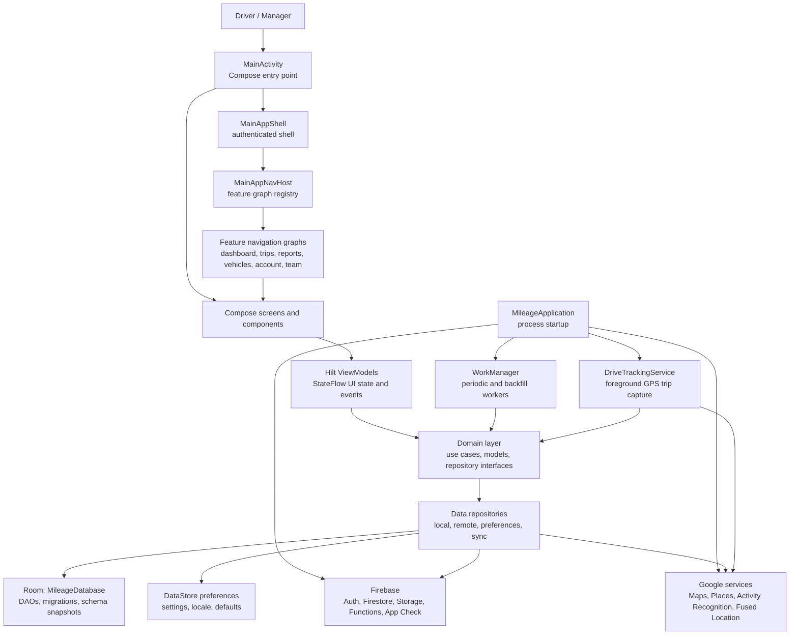
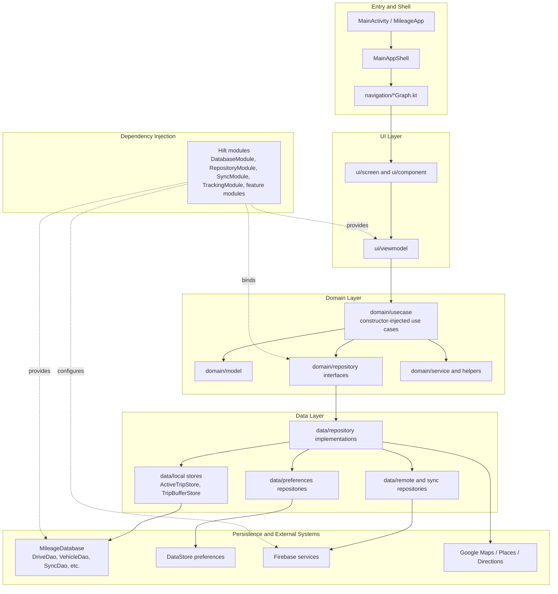
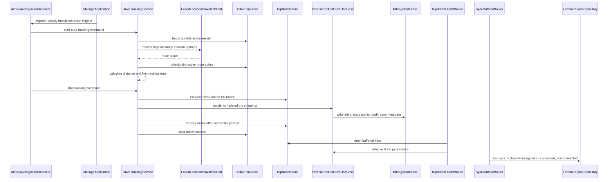

# MileageTracker Architecture

This document is an onboarding map for the Android application. It is based on
the live project structure, navigation docs, and Room inventory.

## System Overview

`MainActivity` owns the first user-facing decision: onboarding, login, or the
authenticated app shell. `MileageApplication` owns process-level setup such as
App Check, Places initialization, locale restoration, CRA rate seeding,
interrupted trip recovery, Activity Recognition registration, and worker
scheduling.

## Layered Dependencies

Use cases are mostly resolved through `@Inject constructor` dependencies. This
checkout does not use a single central `UseCaseModule`; explicit providers are
kept in feature modules where qualifiers, context, or worker infrastructure
need them.

## Runtime Trip Capture

The trip path is designed for local durability first. The foreground service
checkpoints active route points while recording, persists completed trips
through the domain layer, and relies on workers for buffered-trip retries and
cloud sync. `SyncOutboxWorker` has a network constraint; `TripBufferFlushWorker`
intentionally does not, because it only moves local buffered data into Room.

## Maintainer Notes

- Navigation: destination ownership lives under `navigation/*Graph.kt`.
  `MainAppShell` remains the shell/chrome coordinator and should stay focused
  on drawer, app bar, route selection, and top-level ViewModel wiring.
- Persistence: `MileageDatabase` is migration-controlled and exports schema
  snapshots. Entity changes must update the Room version, migration list, and
  schema files.
- Sync: local repositories and DAOs are the source of offline behavior.
  Cloud upload flows pass through sync metadata and outbox handling instead of
  direct UI-to-Firebase writes.
- Tracking: `DriveTrackingService`, `ActiveTripStore`, `TripBufferStore`,
  `RecoverInterruptedTripUseCase`, and the tracking workers form one durability
  boundary. Changes here should be verified with service, worker, and use-case
  tests together.
- Hilt: repository bindings are grouped by feature and store type. Prefer the
  existing module boundaries before adding new modules.
